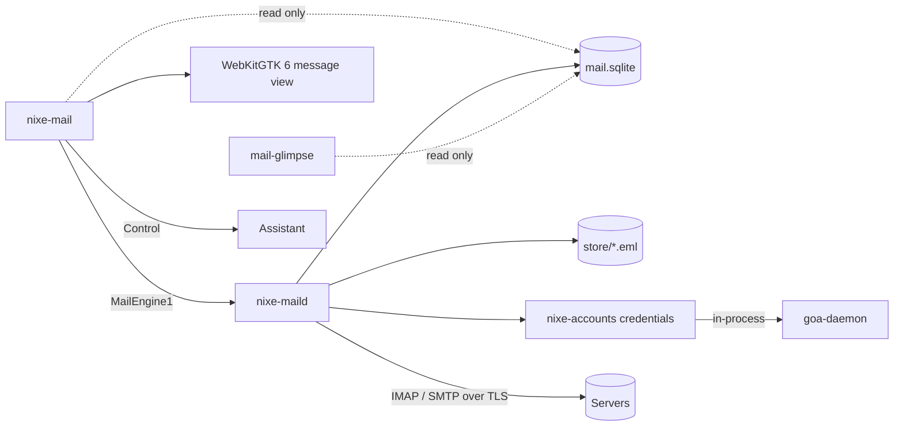

# Mail architecture

## Processes

- **`nixe-maild`** is GTK-free, runs as a systemd user unit (the `nixe-passwordsd`
  shape), and is the only writer of `mail.sqlite` and `store/`. It syncs, runs the ops
  queue, schedules snooze, send later and follow-ups, and sends notifications.
- **`nixe-mail`** is the window. It reads `mail.sqlite` read-only and asks the
  daemon to change anything over `io.github.design_nexus.nixe.MailEngine1`. If the
  daemon is down, cached mail stays readable and changes wait.

## Engine

| Need | Crate |
| --- | --- |
| IMAP | `async-imap` (rustls) |
| SMTP | `lettre` (rustls) |
| MIME | `mail-parser`, `mail-builder` |
| HTML sanitizing | `ammonia` |
| Storage | `rusqlite` (bundled, FTS5) |
| Credentials | `nixe-accounts` (`credentials` feature) |
| Backoff | `nixe-sync::backoff` |

TLS is required. Server settings come from the GOA `Mail` interface; XOAUTH2 when GOA
says so, otherwise the account password from GOA. Credentials are fetched for each
connection and dropped.

## Sync

- Message identity: `(account, mailbox, uidvalidity, uid)`; Gmail also `X-GM-MSGID` to
  merge All Mail copies; labels from `X-GM-LABELS`.
- CONDSTORE/QRESYNC when offered, otherwise UID and flag diffs. IDLE on Inbox.
- UIDVALIDITY change: drop that mailbox's rows and resync; raw messages are reused by hash.
- **Ops queue** (`ops` table): flag, move, copy, append, delete, send. Applied locally at
  once, replayed against the server with backoff. A server value that changed since the
  op was queued is a conflict: the server wins for flags, and moves of vanished messages
  are dropped and reported.
- Account removed in GOA: sync stops; the UI offers to delete the local copy (Undo toast).

## Categories

The Screener and Imbox / Feed / Paper Trail are local metadata (`senders`, `rules`,
`message_category`), never folder moves, so switching back to folders loses nothing.
Feed uses `List-Id` / `List-Unsubscribe`; Paper Trail uses transactional senders and
receipt patterns; user rules win over both.

## Message view

WebKitGTK 6, used for message bodies only:

- HTML is sanitized with `ammonia`, then served from a custom `nixe-mail-msg:` scheme.
- JavaScript, plugins, navigation and every http/https load are off. Images load only
  when allowed for that sender or message. `cid:` parts come from the store.
- Links open in the system browser after showing the real target.
- Theme tokens are injected as CSS. Plain text renders natively.

## Control tools

Reads: `mail.search`, `mail.read`, `mail.summarize`, `mail.important`. Edits:
`mail.draft`, `mail.categorize`. `mail.send` always needs a key press in Assistant and
is not voice-approvable. Mail content is returned with `untrusted_content: true`.
